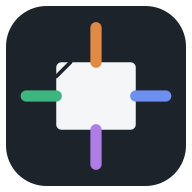
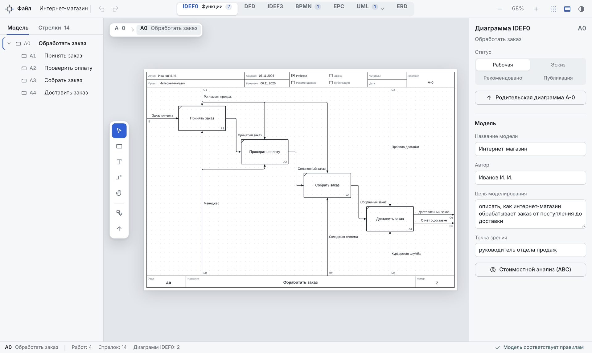
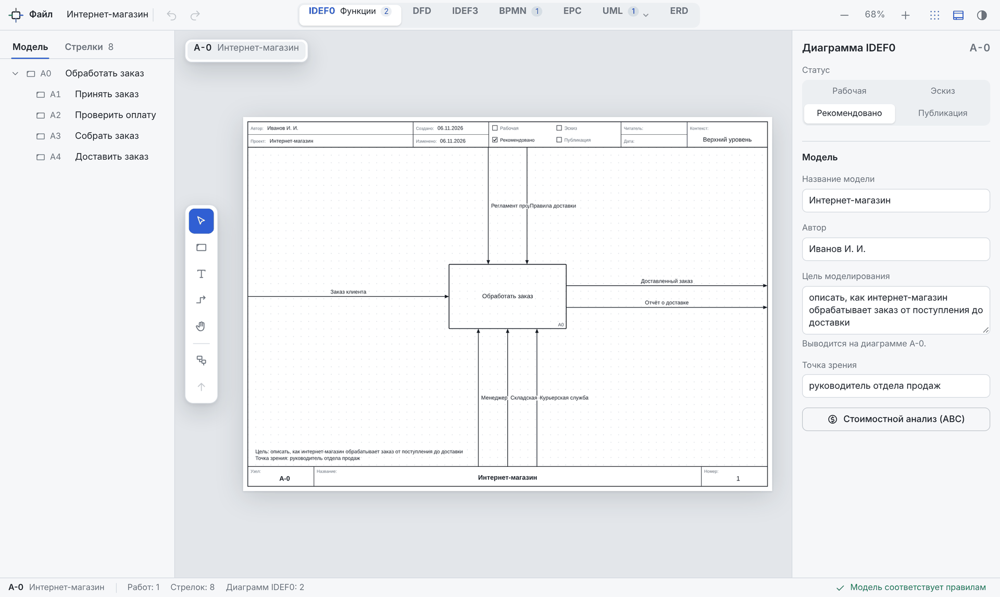
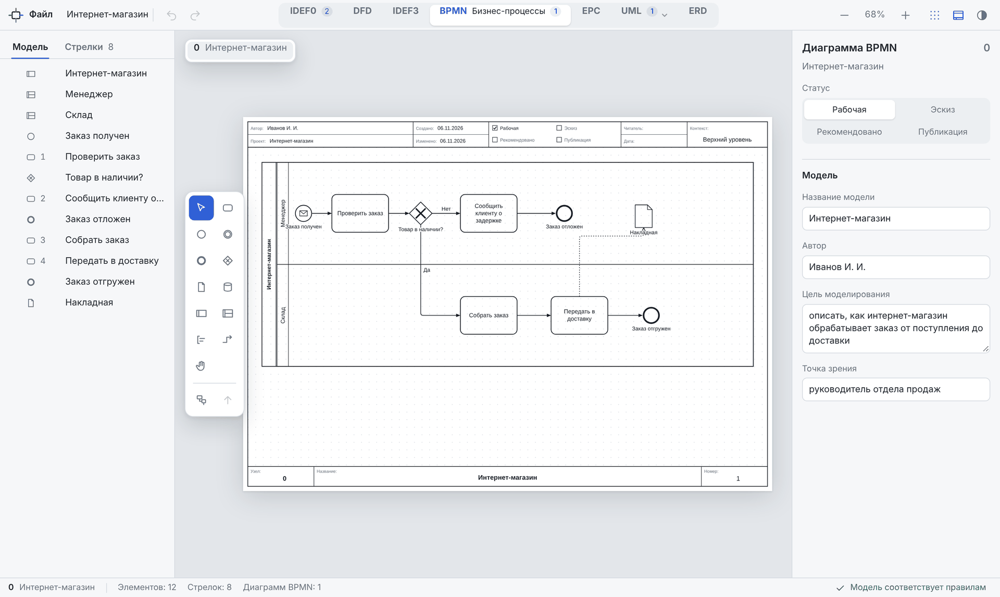
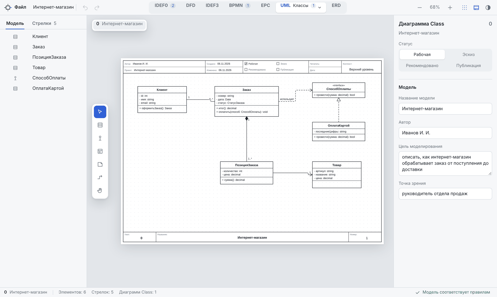
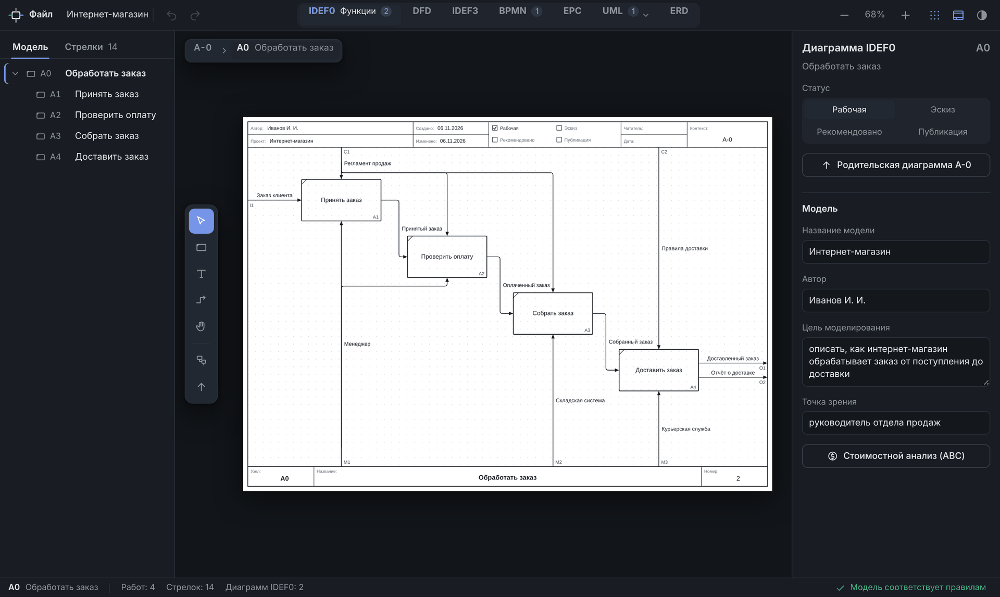

<div align="center">



# Idefka

**Редактор диаграмм IDEF0, DFD, IDEF3, BPMN, EPC, UML и ERD прямо в браузере**

<a href="https://nevasick.github.io/Idefka/"></a>

[Возможности](#возможности) ·
[Быстрый старт](#быстрый-старт) ·
[Разработка](#разработка)


<a href="https://nevasick.github.io/Idefka/"></a>

</div>

## О проекте

Idefka — бесплатная альтернатива BPwin и похожим программам. Сделана в первую очередь для студентов:
курсовые и лабораторные по IDEF0, DFD, BPMN и UML. Подходит и для описания бизнес-процессов на работе.

- **Всё в браузере.** Модели никуда не отправляются: приложение — это статические файлы, а данные остаются у вас.
  Одной ссылкой могут пользоваться сколько угодно людей одновременно, у каждого своя копия.
- **Работает без интернета.** После первого открытия приложение сохраняется в браузере;
  его можно установить и запускать из «Пуска», как обычную программу.
- **Открытый формат.** Файл `.idef` — это JSON. Старые файлы открываются в новых версиях.

## Возможности

### 11 видов диаграмм

| Нотация | Что есть |
| --- | --- |
| **IDEF0** | Контекстная диаграмма A-0, декомпозиция на любую глубину, нумерация A0, A1, A12…, стрелки входа, управления, выхода и механизма, граничные стрелки с кодами ICOM, туннели (граничную стрелку в декомпозиции можно убрать в туннель клавишей Delete) |
| **DFD** | Процессы, внешние сущности, хранилища, потоки данных (в том числе двунаправленные), нумерация 1, 1.1, 1.2… |
| **IDEF3** | Единицы работы, перекрёстки И / ИЛИ / исключающее ИЛИ (синхронные и асинхронные), объекты ссылки, связи предшествования и потоки объектов |
| **BPMN** | Задачи и подпроцессы, события (сообщение, таймер, ошибка, сигнал…), шлюзы, пулы и дорожки, объекты и хранилища данных, аннотации |
| **EPC** | События, функции, операторы И / ИЛИ / XOR, оргединицы, информационные объекты, документы, прикладные системы |
| **UML** | Прецеденты, классы, последовательность, деятельность, развёртывание |
| **ERD** | Сущности с ключами и атрибутами, идентифицирующие и неидентифицирующие связи, кратность «вороньи лапки» |

У каждой нотации своё дерево диаграмм, свои элементы и своя проверка по правилам:
например, IDEF0 следит за числом работ на диаграмме, а EPC — за чередованием событий и функций.

### Стрелки

- Прокладываются сами под прямыми углами и обходят блоки.
- Отрезок можно перетащить — маршрут запомнится; вернуть автоматический можно одной кнопкой.
- **Ветвление и слияние**, как в BPwin: потяните от стрелки с Alt или бросьте конец на другую стрелку.
- «Молния», которая связывает отведённую подпись со стрелкой, цвета и многострочные названия.
- Чтобы изменить размер подписи, выделите её и потяните за нижний правый угол. При сужении текст переносится на новые строки.

### Стоимостной анализ (ABC)

Центры затрат, стоимость, частота и длительность работ. Стоимость декомпозированной работы считается
сама из дочерних, её можно вывести на диаграмму и выгрузить отчёт в CSV для Excel.

### Остальное

Отмена и повтор, автосохранение черновика, экспорт в PNG и SVG, печать и PDF всей модели
(каждая диаграмма на отдельном листе A4 с рамкой), светлая и тёмная темы.

## Скриншоты

<table>
  <tr>
    <td></td>
    <td></td>
  </tr>
  <tr>
    <td align="center">Контекстная диаграмма IDEF0</td>
    <td align="center">BPMN: пул, дорожки, шлюз</td>
  </tr>
  <tr>
    <td></td>
    <td></td>
  </tr>
  <tr>
    <td align="center">Диаграмма классов UML</td>
    <td align="center">Тёмная тема</td>
  </tr>
</table>

## Быстрый старт

1. Нажмите **«Открыть Idefka»** в начале страницы — устанавливать ничего не нужно.
2. Выберите нотацию на вкладках вверху и рисуйте: элементы — на панели слева, свойства — справа.
3. **Ctrl+S** сохраняет модель в файл `.idef`. В Chrome, Edge и Яндекс Браузере следующие Ctrl+S
   записывают прямо в тот же файл, в Firefox и Safari файл каждый раз скачивается.
4. Чтобы запускать как программу: **Файл → Установить как приложение**
   (или значок установки в адресной строке Chrome, Edge, Яндекс Браузера).

### Горячие клавиши

| Клавиши | Действие |
| --- | --- |
| `V` / `A` / `H` | Выбор / стрелка / рука |
| Двойной щелчок, `F2` | Переименовать |
| `Shift+Enter` | Новая строка в названии |
| `D` / `Alt+↑` | Декомпозиция / на уровень выше |
| `Alt` + тянуть от стрелки | Ветвь стрелки |
| `Ctrl+Z` / `Ctrl+Y` | Отменить / повторить |
| `Ctrl+S` / `Ctrl+P` | Сохранить / печать и PDF |

Полный список — по **F1** в приложении.

## Запуск на своём компьютере

Нужен [Node.js](https://nodejs.org) (версия LTS).

**Windows:** дважды щёлкните `start-idefka.bat`. При первом запуске он установит зависимости
(около минуты), затем откроет приложение в браузере. Пока окно открыто, приложение работает.

**Любая система:**

```bash
npm install
npm start
```

## Разработка

```bash
npm install
npm run dev        # http://localhost:5173, страница обновляется после правок в src/
npm run typecheck  # проверка типов
npm run build      # сборка в dist/
```

Зависимости минимальные: в браузере работает только React, для сборки нужны esbuild и TypeScript.

### Структура

```
src/
  model/         модель без React: типы файла, нотации, трассировка стрелок,
                 геометрия, проверка правил, ABC, чтение файлов и миграции
  components/
    sheet/       отрисовка листа: рамка, стрелки, фигуры всех нотаций
    canvas/      холст: жесты мыши, масштаб, редактор подписей, панель инструментов
    inspector/   панель свойств
    dialogs/     окна: декомпозиция, новая модель, ABC, справка
  actions/       команды: файлы, экспорт, навигация
  store.ts       состояние и история отмены
  platform.ts    работа с файлами в браузере
  pwa.ts         установка и работа офлайн
scripts/build.mjs  сборка и dev-сервер на esbuild
docs/              скриншоты
```
